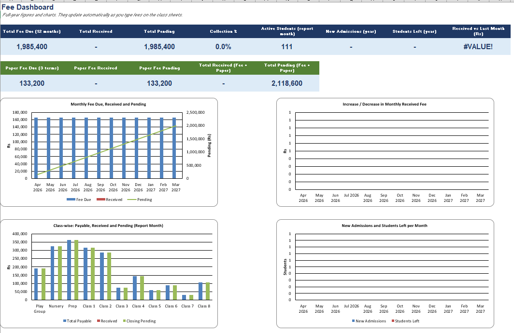

# Project 1: School Student Performance Analysis

Student Performance Analysis using SQL and Excel.

## Project Overview
This project analyzes student performance data of 300 students from Class 6 to Class 10.

## Tools Used
- MySQL
- Microsoft Excel
- SQL

## Dataset
- 300 Students
- 5 Subjects
- Attendance Records
- Class and Section Data

## SQL Analysis
- Subject-wise Average Marks
- Class-wise Performance
- Pass and Fail Analysis
- Attendance Analysis
- Top 10 Students
- Bottom 10 Students

## Key Findings
- Overall pass rate was 91.67% (275 of 300 students passed).
- Class 9 had the lowest pass rate (88.33%); Class 10 had the highest (96.67%).
- English was the weakest subject (average 56.6 vs. 67.0 in Computer); 15 of the 25 failed students scored below 33 in English.
- Attendance and performance are positively related (correlation 0.47): students with 90%+ attendance had a 2.6% fail rate, compared to 15.4% for students below 70% attendance.
- Gender and section had little effect on results.

*Note: The dataset is simulated and created for practice.*
  
## Project Files
- Excel Dashboard
- CSV Dataset
- SQL Queries

## Author
School Performance Analysis Project
## Dashboard Preview

## Project 2: School Fee Management System 2026–27
### Project Overview
An automated school fee management system developed using Microsoft Excel to manage student records, monthly fee collections, pending payments, and annual financial summaries.

### Key Features
- Class-wise student records from Play Group to Class 8.
- Student name dropdown lists for accurate data entry.
- Monthly fee tracking and payment status.
- Paid, unpaid, and advance fee management.
- Automated fee calculations.
- Receipt logging system.
- Annual financial summary.
- Interactive Excel dashboard.
- Automated reporting and data management.

### Tools & Technologies
- Microsoft Excel
- Excel Formulas
- Data Validation
- Dropdown Lists
- Data Analysis
- Dashboard & Reporting

### Project Year
2026–27
## Dashboard Preview

